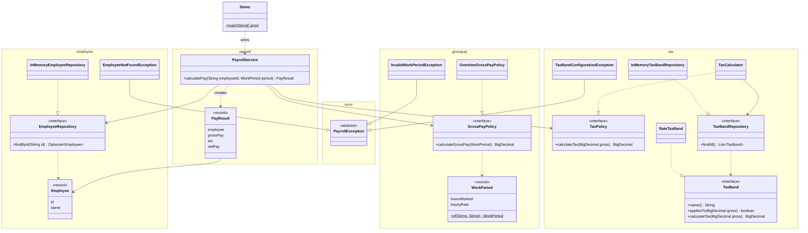

# Rosewood Payroll

Calculates an employee's gross pay, tax and net pay for a work period. Gross pay includes
overtime, and tax comes from a table of tax bands.

The service started as code written quickly with an AI assistant. It has been refactored so each
class has one job, its dependencies are injected, failures are reported (never turned into a zero
payslip), and the tests check the real behaviour. [ANALYSIS.md](ANALYSIS.md) lists what was wrong
with the original code and its tests, and [RATIONALE.md](RATIONALE.md) explains the decisions.

## Requirements

- JDK 21
- Maven 3.9 or later

## Running the demo

```bash
mvn compile exec:java -Dexec.mainClass=com.rosewood.payroll.Demo
```

Expected output:

```
Efua Sarpong (e1): gross GHS 800.00, tax GHS 40.00, net GHS 760.00
Kwame Owusu (e2): gross GHS 1650.00, tax GHS 247.50, net GHS 1402.50
Pay NOT calculated for unknown: No employee found with id 'unknown'
Pay NOT calculated for e1: Hours worked must not be negative: -5
```

The last two lines are expected. They show that an unknown employee and invalid hours are
reported as failures; the original code returned a net pay of 0 for both.

## Running the tests

```bash
mvn test
```

Coverage report (JaCoCo), written to `target/site/jacoco/index.html`:

```bash
mvn verify
```

Mutation testing (PIT), written to `target/pit-reports/index.html`. PIT makes small changes to the
code, such as turning `<` into `<=`, and checks that a test fails for each one:

```bash
mvn test-compile org.pitest:pitest-maven:mutationCoverage
```

## How pay is calculated

`PayrollService.calculatePay(employeeId, period)`:

1. Looks up the employee. An unknown id throws `EmployeeNotFoundException`.
2. Works out gross pay with the `GrossPayPolicy` and rounds it to 2 decimal places.
3. Works out tax on the rounded gross with the `TaxPolicy` and rounds it to 2 decimal places.
4. Returns a `PayResult` where net = gross − tax. `PayResult` refuses amounts that don't add up.

All money is `BigDecimal`, built from strings, so no amounts carry floating-point errors.

### Current rules

| Rule | Value | Configured in |
|---|---|---|
| Standard hours per period | 40 | `Demo` |
| Overtime premium | 0.5 (time-and-a-half on hours above 40) | `Demo` |
| LOW band | gross 0 up to 1,000: 5% | `Demo` |
| MEDIUM band | gross 1,000 up to 5,000: 15% | `Demo` |
| HIGH band | gross 5,000 and above: 25% | `Demo` |
| Rounding | HALF_UP to 2 decimal places, applied to gross and to tax | `PayrollService` |

Each band covers its lower limit and stops just below its upper limit, so gross pay of exactly
1,000.00 is in MEDIUM.

### Assumptions

These rules came from the original code. They need confirming by the business:

- **Each band taxes the whole gross pay, not only the part above its lower limit.** Tax jumps at
  each limit: 999.99 pays 50.00 tax, 1,000.00 pays 150.00.
- The pay period is weekly, which is what the 40-hour overtime threshold suggests.
- HALF_UP is the required rounding method.
- No deductions (such as pension contributions) are taken before tax.

## Project structure

Classes are grouped by feature under `com.rosewood.payroll`:

| Package | Responsibility |
|---|---|
| *(root)* | `Demo`: the composition root. It creates the concrete classes, wires them together and runs examples. |
| `payroll` | `PayrollService` coordinates one pay calculation; `PayResult` holds the outcome. |
| `employee` | `Employee` and how employees are found (`EmployeeRepository`). |
| `grosspay` | `WorkPeriod` (hours and rate) and how gross pay is worked out (`GrossPayPolicy`). |
| `tax` | Tax bands, where they come from, and `TaxCalculator`, which applies them. |
| `error` | `PayrollException`, the base class for every payroll failure. |

`employee`, `grosspay` and `tax` don't depend on each other. `PayrollService` is the only class
that uses all three, and it depends only on their interfaces.



| Arrow | Meaning |
|---|---|
| `──▷` (solid, hollow head) | extends (inheritance) |
| `┈┈▷` (dashed, hollow head) | implements an interface |
| `──>` (solid) | holds a reference, passed in through the constructor |
| `┈┈>` (dashed) | uses or creates it in a method |

## Error handling

Two kinds of failure are treated differently:

| Kind | Exception | What happens |
|---|---|---|
| A pay calculation can't be done | `EmployeeNotFoundException`, `InvalidWorkPeriodException`, `TaxBandConfigurationException` (all extend `PayrollException`) | Thrown to the caller. `Demo` catches `PayrollException`, reports that employee's pay as not calculated, and carries on with the next. |
| The setup is invalid | `IllegalArgumentException` (for example a duplicate employee id, or a tax band with a value that isn't a number) | Thrown at startup, so the program stops before anyone is paid. |
| A required value is missing | `NullPointerException` naming the missing value | Thrown immediately, where the `null` was passed in. |

No exception is caught and ignored, and no failure produces a zero or partial payslip. Error
messages and `toString()` include employee ids but never names or pay amounts.

`TaxCalculator` also checks the tax table every time it is used. It refuses to calculate tax when:
- no band covers the gross pay (a gap between bands)
- more than one band covers it (overlapping bands)
- a band returns tax below 0 or above the gross pay

## Adding a tax band

**New numbers only** (another range and rate): add a `RateTaxBand` to the band list in `Demo`, for
example `RateTaxBand.between("NAME", "lowerLimit", "upperLimit", "rate")`. No new code is needed.

**New rules** (a different calculation): create a class in the `tax` package that implements
`TaxBand`, and add an instance of it to the band list in `Demo`. `TaxCalculator`,
`PayrollService` and the existing bands don't change. The new class must:

- cover a range of gross pay that doesn't overlap any other band and leaves no gap;
- return tax between 0 and the gross pay, unrounded (`PayrollService` rounds it);
- check its own settings in its constructor, so a wrong setting stops the program at startup.

In both cases, adjust the neighbouring band's limits. For example, give the current top band an
upper limit before adding a band above it. If they overlap or leave a gap, `TaxCalculator`
rejects the calculation with a message naming the bands, so a wiring mistake can't produce wrong
pay.

## Tests

The tests are in `src/test/java`, in the same packages as the classes they check. Every
calculation and validation class has its own test class:

- Each test asserts an exact amount, or an exact exception type and message. None pass just because
  the code ran.
- Money values are checked on both sides of every limit: band limits, the 40-hour overtime threshold,
  and the 0 and gross-pay edges of the tax check.
- Test doubles stand in only for collaborators. The class under test is always the real one.
  Mockito creates misbehaving tax bands; small lambdas stand in for the one-method gross pay and
  tax policies.
- `MoneyAssertions.assertAmount` compares amounts by value, so `150` equals `150.0000`. Unrounded
  results are compared that way; `PayrollService` results are compared exactly, including the
  2 decimal places.
