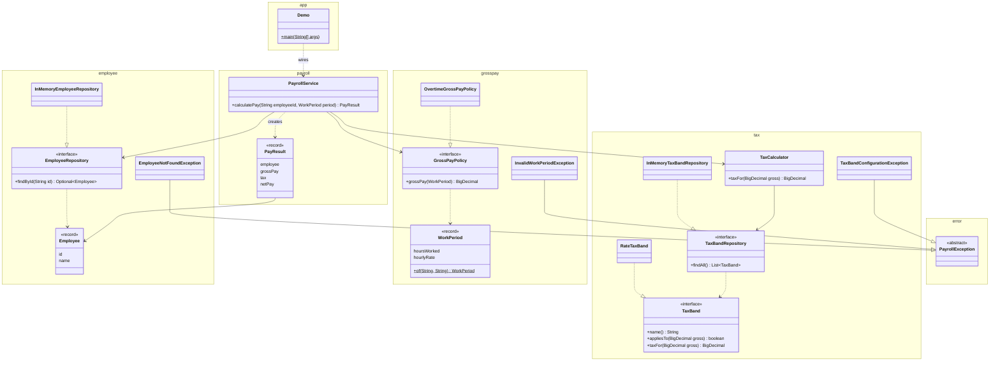

# Rosewood Payroll — Net Pay Service

This is the starter repository for the **Code Quality & Testing** applied lab.
Read the lab brief alongside this repository; it explains the business, what you
are being asked to deliver, and how your work is assessed.

## What this is

A small net-pay service that was written quickly with an AI assistant, together with the
tests it produced. Everything compiles and the tests pass, so at a glance it
looks finished. Your job is to bring it up to AmaliTech standard: judge what is
actually wrong with the code **and** its tests, refactor it, make it genuinely
testable, handle its failures properly, and replace the tests that only look
like tests.

## Running it

You need JDK 21 and Maven.

**See the service run (a small demo, no tests):**

```bash
mvn compile
mvn exec:java -Dexec.mainClass=com.rosewood.payroll.Demo
```

**Run the existing tests:**

```bash
mvn test
```

**Measure your tests** (coverage and mutation testing are already set up):

```bash
mvn verify                                                  # tests + JaCoCo report: target/site/jacoco/index.html
mvn test-compile org.pitest:pitest-maven:mutationCoverage   # PIT report: target/pit-reports/index.html
```

Run the demo and the tests before you change anything. Note what the demo prints for an unknown employee,
and look carefully at whether the tests that pass actually prove anything.

## What to hand in

See the lab brief for the full list: your written analysis (of the code and the
tests), the refactored code, robust exception handling, a real test suite, a
short rationale, and one improvement beyond the brief. You will talk through your
work in a live review.

## Design

Classes are grouped by feature. `employee`, `grosspay` and `tax` don't depend on each other: `PayrollService` is the only class that uses all three, and `Demo` (the composition root) wires the concrete classes together. A new tax rule is a new `TaxBand` implementation plus one line in `Demo`; no existing class changes.



**How to read the arrows**

| Arrow | Meaning |
|---|---|
| `──▷` (solid, hollow head) | extends (inheritance) |
| `┈┈▷` (dashed, hollow head) | implements an interface |
| `──>` (solid) | holds a reference, injected through the constructor |
| `┈┈>` (dashed) | uses or creates it in a method |
